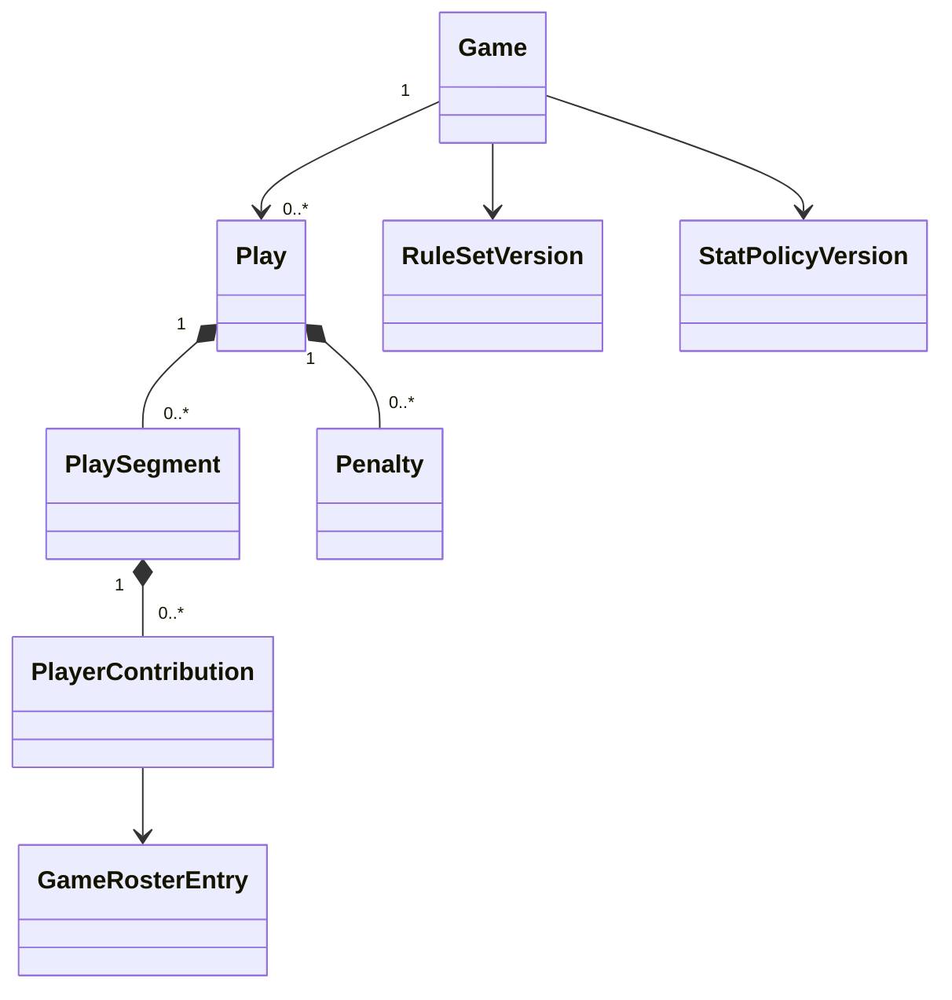

# Plateforme de statistiques sportives — Stack, architecture et modèles métier

Date : 3 novembre 2026 · Version : 0.1 · Proposition technique à valider par un pilote.

Document associé : [vision, marché et stratégie](sports_stats_vision_marche.md).

## 1. Périmètre et principes

Le produit prend en charge le **football américain avec contact et le flag football**. Le socle devra permettre d’ajouter d’autres sports, sans imposer les notions de tentative, yards ou possession à tous les futurs modules.

Principes : saisie locale fiable, synchronisation explicite, règles déterministes, traçabilité des corrections et statistiques reconstructibles. La voix et la vidéo proposent des observations ; la validation métier reste la même pour tous les canaux.

Architecture recommandée : **monolithe modulaire, Clean Architecture pragmatique et DDD**. Utiliser des événements internes quand ils simplifient le découplage. Un journal de révisions ne signifie pas qu’un système complet d’Event Sourcing soit nécessaire.

## 2. Stack recommandée

| Couche | Choix | Motif / limite |
| --- | --- | --- |
| Backend | Python + Django | Authentification, administration, ORM et migrations ; productivité sur la gestion [T1] |
| API | Django REST Framework | API REST, sérialisation, validation des entrées et permissions |
| Frontend | React + TypeScript + Vite | Poursuivre l’apprentissage déjà engagé sur l’ERP |
| Mobile | PWA responsive | Une base web installable, utilisable sur tablette, mobile et ordinateur |
| Local | IndexedDB via Dexie.js | Stockage des matchs, jeux et commandes en attente [T2] |
| Base serveur | PostgreSQL | Transactions, contraintes et requêtes statistiques |
| Écrans publics | Actualisation périodique, puis SSE | Diffusion serveur → navigateur ; écritures par REST [T3] |
| Graphiques | Recharts, si les premiers dashboards le nécessitent | Tableaux lisibles en priorité ; choix de bibliothèque réévaluable |
| Tâches différées | Processus de travail séparé, puis Celery + Redis si nécessaire | Transcription, exports lourds et traitements vidéo |
| Médias | Stockage objet compatible S3 | Audio et vidéo hors des lignes de la base |
| Déploiement | Docker + serveur HTTP/ASGI + PostgreSQL | Déploiement reproductible ; ajouter les services selon les besoins |
| Qualité Python | pytest, Ruff, Pyright | Métier, intégration et vérification statique |
| Qualité frontend | Vitest, Testing Library, Playwright | Composants et parcours navigateur hors ligne |

Les versions exactes seront choisies parmi les versions stables maintenues et compatibles au démarrage, puis verrouillées. Cette note ne fixe pas une version dite « dernière ».

### Django et FastAPI

Django est recommandé pour le produit car il réduit le travail sur la gestion des organisations et des comptes. FastAPI reste une alternative cohérente si la priorité est de réutiliser l’atelier actuel. Ne pas maintenir deux frameworks backend dans le MVP. Les modèles métier en Python pur permettent de garder le choix de transport indépendant.

### PWA et React Native

La PWA utilise React, TypeScript, HTML et CSS ; **elle n’utilise pas React Native**. Un manifest décrit son installation. Un service worker met en cache les ressources nécessaires. IndexedDB stocke les données métier locales.

Le cache des fichiers ne suffit pas à rendre la saisie hors ligne. La première préparation du match requiert une connexion. Les comportements de stockage, microphone et suspension doivent être testés sur les appareils visés, notamment Safari iOS et Chrome Android. Le stockage navigateur ne remplace pas une sauvegarde durable.

## 3. Organisation des modules

| Module | Responsabilité |
| --- | --- |
| access | Organisations, utilisateurs, appartenances et permissions |
| competitions | Saisons, compétitions, disciplines, versions des règlements |
| participants | Équipes, joueurs, effectifs de saison et de match |
| games | Cycle de vie et événements généraux du match |
| gridiron | Jeux, contributions, pénalités et règles football/flag |
| statistics | Calculs, projections, agrégats et exports |
| capture | Réception des commandes, déduplication et synchronisation |
| media | Audio, vidéo, propositions IA et références temporelles |
| publishing | Pages publiques et flux de mises à jour |

Dans chaque module : `domain/`, `application/`, `infrastructure/` et `interfaces/` selon son besoin réel. Le domaine ne dépend pas de Django, DRF ou du navigateur. Les cas d’usage orchestrent les règles et les ports. Les adaptateurs persistent les objets et exposent l’API.

Les modèles ORM et les dataclasses métier ont des responsabilités différentes. Utiliser des mappers explicites lorsque cette séparation apporte de la valeur, sans abstraire chaque CRUD simple par principe.

## 4. Modèle conceptuel

**Un jeu est un fait observé ; les contributions attribuent des rôles ; les statistiques sont des résultats calculés.**

Un jeu peut contenir plusieurs segments : passe, interception, retour, fumble, récupération, nouveau retour. Une seule position initiale/finale ne permettrait pas de distinguer les yards attribuables à chaque phase.



Le diagramme ne représente que le noyau football/flag. Les futurs sports partageront équipes, participants, matchs, accès et publication ; ils pourront avoir leurs propres événements métier.

## 5. Catalogue des modèles et propriétés

### Organisations, participants et compétitions

| Modèle | Propriétés principales |
| --- | --- |
| Organization | id, name, locale, timezone, status |
| Membership | id, organization_id, user_id, role |
| Competition | id, organization_id, name, discipline, season_id, rule_set_version_id, stat_policy_version_id |
| Season | id, name, starts_on, ends_on |
| Team | id, organization_id, name, abbreviation |
| Player | id, organization_id, first_name, last_name ; autres données seulement si nécessaires |
| GameRosterEntry | id, game_id, player_id, team_id, jersey_number, position, participation_status |
| Game | id, organization_id, competition_id, home_team_id, away_team_id, scheduled_at, venue, status, rule_set_version_id, stat_policy_version_id, revision |

Le numéro est une chaîne pour préserver « 00 ». Les règles d’unicité des numéros et les exceptions dépendent de la compétition : ne pas imposer une règle universelle sans validation. Un joueur peut ne pas avoir encore été identifié ; ne pas créer un faux joueur pour satisfaire une contrainte.

Un match appartient à une organisation responsable. Un club extérieur peut être invité avec des droits explicites sur ce match. Ne pas fusionner automatiquement les identités de joueurs entre organisations.

### Règlement sportif et conventions statistiques

| Modèle | Propriétés principales |
| --- | --- |
| RuleSetVersion | id, name, version, discipline, field_length, field_width, distance_unit, regulation_players, period_count, period_duration, first_down_mode, downs_limit, conversion_options, allowed_play_types, penalty_rules |
| StatPolicyVersion | id, name, version, supported_metrics, sack_attribution, assisted_defense_credit, penalty_stat_rules, formula_version |

Le règlement décrit le déroulement du sport. Le référentiel statistique décrit comment compter les faits : attribution des sacks, crédits défensifs et traitement des pénalités, par exemple. Certains comportements nécessitent des stratégies Python testées ; ils ne se réduisent pas tous à des valeurs JSON.

Les versions utilisées par un match sont immuables. Un changement futur de règlement ne doit pas changer silencieusement les résultats historiques. Une migration statistique volontaire doit être identifiable.

### Jeu et segments

| Modèle | Propriétés principales |
| --- | --- |
| GameClock | period, seconds_remaining ; valeur optionnelle si inconnue |
| FieldPosition | distance_from_home_goal ; unité et longueur issues du règlement |
| PlayContext | possession_team_id, clock, ball_position, down, target_position, offense_direction |
| Play | id, game_id, order_key, version, context_before, segments, penalties, review_status, effects, scoring_events, source, captured_by, recorded_at |
| PlaySegment | id, ordinal, segment_type, acting_team_id, start_position, end_position, outcome, contributions |
| PlayerContribution | id, roster_entry_id optionnel, observed_jersey_number optionnel, role, attribution_status |
| Penalty | id, rule_code, team_id, roster_entry_id optionnel, timing, disposition, enforcement_origin, enforced_position, down_effect |
| PlayEffects | next_possession_team_id, next_down, next_target_position, next_ball_position ; dérivés du règlement et des décisions confirmées |
| ScoringEvent | id, scoring_team_id, kind, points, segment_id optionnel, beneficiary_roster_entry_id optionnel |

Position canonique : axe fixe entre les deux lignes de but, de 0 à la longueur du terrain. L’attaque avance dans le sens +1 ou -1. Une position dans une end zone peut dépasser cet intervalle selon la convention documentée. L’affichage « ses 30 yards » est une conversion UI. Ce choix évite une ambiguïté au milieu du terrain et fonctionne pour plusieurs longueurs de terrain.

`order_key` exprime l’ordre de jeu indépendamment du chronomètre et de l’UUID. Pour le MVP, le serveur peut attribuer des entiers espacés et réordonner transactionnellement lors d’une insertion. Le numéro affiché est dérivé. Les références restent basées sur l’UUID, jamais sur ce numéro.

Les segments portent les déplacements observés ; les contributions portent les rôles. Les pénalités ont leur propre application. **Ne pas calculer tous les yards statistiques depuis la position finale du ballon après pénalité.**

### Statuts distincts

- Match : scheduled, in_progress, under_review, final, cancelled.
- Relecture du jeu : draft, needs_review, confirmed.
- Pénalité : accepted, declined, offsetting, pending.
- Attribution joueur : identified, unknown, needs_review.
- Synchronisation : local_only, pending, synced, conflict ; état technique local, distinct du statut sportif.

Un jeu peut être correctement synchronisé tout en restant à vérifier. Une pénalité peut annuler certains effets sans effacer l’observation originale.

### Rôles et types propres aux disciplines

Rôles possibles : passer, receiver, rusher, interceptor, returner, tackler, assisted_tackler, flag_puller, fumble_forcer, fumble_recoverer, kicker. La disponibilité et les conditions dépendent du règlement.

Types de segments initiaux : rush, pass, interception_return, kick, kick_return, fumble, recovery, lateral. Les timeouts, changements de période et corrections de chronomètre sont des événements généraux de match, pas des contributions de joueur artificielles.

## 6. Extrait Python du noyau métier

Exemple structurel, Python 3.11 ou supérieur pour `StrEnum`. Ce code illustre les frontières ; les validations et transitions sont à implémenter dans les fabriques et méthodes métier. Il ne constitue pas un moteur statistique complet.

```python
from dataclasses import dataclass
from datetime import datetime
from decimal import Decimal
from enum import StrEnum
from uuid import UUID


class Discipline(StrEnum):
    TACKLE_FOOTBALL = "tackle_football"
    FLAG_FOOTBALL = "flag_football"


class ReviewStatus(StrEnum):
    DRAFT = "draft"
    NEEDS_REVIEW = "needs_review"
    CONFIRMED = "confirmed"


class SegmentType(StrEnum):
    RUSH = "rush"
    PASS = "pass"
    INTERCEPTION_RETURN = "interception_return"
    KICK = "kick"
    KICK_RETURN = "kick_return"
    FUMBLE = "fumble"
    RECOVERY = "recovery"
    LATERAL = "lateral"


class ContributionRole(StrEnum):
    PASSER = "passer"
    RECEIVER = "receiver"
    RUSHER = "rusher"
    INTERCEPTOR = "interceptor"
    RETURNER = "returner"
    TACKLER = "tackler"
    ASSISTED_TACKLER = "assisted_tackler"
    FLAG_PULLER = "flag_puller"
    FUMBLE_FORCER = "fumble_forcer"
    FUMBLE_RECOVERER = "fumble_recoverer"
    KICKER = "kicker"


@dataclass(frozen=True)
class GameClock:
    period: int
    seconds_remaining: int


@dataclass(frozen=True)
class FieldPosition:
    distance_from_home_goal: Decimal


@dataclass(frozen=True)
class PlayContext:
    possession_team_id: UUID
    clock: GameClock | None
    ball_position: FieldPosition
    down: int | None
    target_position: FieldPosition | None
    offense_direction: int  # +1 ou -1


@dataclass(frozen=True)
class PlayerContribution:
    id: UUID
    team_id: UUID
    role: ContributionRole
    roster_entry_id: UUID | None = None
    observed_jersey_number: str | None = None


@dataclass(frozen=True)
class PlaySegment:
    id: UUID
    ordinal: int
    segment_type: SegmentType
    acting_team_id: UUID
    start_position: FieldPosition
    end_position: FieldPosition | None
    outcome: str  # À remplacer par des résultats typés selon le segment
    contributions: tuple[PlayerContribution, ...]


@dataclass(frozen=True)
class Play:
    id: UUID
    game_id: UUID
    order_key: int
    version: int
    context_before: PlayContext
    segments: tuple[PlaySegment, ...]
    review_status: ReviewStatus
    captured_by: UUID
    recorded_at: datetime
```

L’extrait se concentre sur le jeu et ses segments ; `Penalty`, `ScoringEvent` et `RuleSetVersion` sont décrits dans le catalogue et restent à implémenter. `frozen=True` demande de retourner une nouvelle instance pour une correction. Cela n’apporte pas seul la validation métier, l’immutabilité de tous les objets référencés ni le contrôle de concurrence en base.

Pour la suite, remplacer les combinaisons libres `segment_type/outcome` par des objets typés (`PassSegment`, `RushSegment`…) lorsqu’elles multiplient les états impossibles. Éviter un champ universel `value` pour toutes les mesures.

## 7. Invariants et calculs

Invariants à valider au niveau domaine et, lorsque possible, par contraintes de base :

1. Les deux équipes du match sont distinctes.
2. Tout joueur attribué appartient à l’effectif du match et à l’équipe de sa contribution.
3. Une passe complétée confirmée possède les attributions requises, ou des inconnues explicitement admises par le workflow.
4. Le rôle `flag_puller` est disponible pour les règlements flag ; la disponibilité des plaquages et autres rôles est contrôlée par la discipline.
5. Les positions, périodes et tentatives sont compatibles avec le règlement ; ne pas limiter toutes les tentatives à quatre en dur.
6. Une correction d’un match final requiert une réouverture autorisée.
7. L’ordre, les changements de possession et les segments restent cohérents, ou sont marqués à vérifier.

### Exemple de calcul

Une passe complétée de 15 yards avec un passeur, un receveur et un défenseur génère une tentative, une complétion et 15 yards pour le passeur ; une réception et 15 yards pour le receveur ; un crédit défensif selon le règlement. Les yards offensifs de l’équipe augmentent de 15, pas de 30.

Une interception suivie d’un retour nécessite des segments distincts pour éviter d’attribuer les yards de retour à l’attaque. Les jeux annulés et pénalités appliquent le référentiel statistique. Les sacks, crédits partagés et conversions nécessitent des cas de référence approuvés par le statisticien pilote.

### Vues calculées

`PlayerGameStats`, `TeamGameStats`, `PlayerSeasonStats` et `GameScore` sont des projections reconstructibles. Chaque résultat matérialisé conserve `source_game_revision`, `stat_policy_version_id`, `calculator_version` et `computed_at`.

La source de vérité reste le journal des jeux confirmés et de leurs révisions. Les observations incomplètes peuvent alimenter une vue provisoire clairement identifiée. Pour démarrer, recalculer le match après une correction est souvent plus simple qu’entretenir de nombreux compteurs inverses ; mesurer avant d’optimiser.

## 8. Agrégats, cas d’usage et ports

`Play` constitue un agrégat éditable avec segments, contributions et pénalités. `Game` protège son cycle de vie et sa configuration sans charger tous les jeux. Une insertion ou une correction peut affecter le contexte des jeux suivants : le cas d’usage coordonne la transaction et la revalidation.

Cas d’usage initiaux : `PrepareGame`, `RecordPlay`, `CorrectPlay`, `InsertPlay`, `ReviewGame`, `FinalizeGame`, `ReopenGame`, `RebuildGameStats` et `SyncCommands`.

Ports ciblés : `GameRepository`, `PlayRepository`, `UnitOfWork`, `StatsProjector`, `MediaStorage`, `Transcriber`. Des `Protocol` Python peuvent exprimer ces contrats. Les dépôts métier privilégient des opérations utiles (`list_ordered_for_game`, `save_if_version`) plutôt qu’un contrat CRUD générique imposé à tout.

## 9. Synchronisation hors ligne

### Flux

1. Télécharger la configuration, les effectifs et la dernière révision du match.
2. À la saisie, écrire **dans une même transaction IndexedDB** le jeu local et sa commande dans une outbox locale.
3. Afficher le résultat et son statut local ; ne pas annoncer une sauvegarde serveur prématurée.
4. Envoyer les commandes dans leur ordre causal quand l’application est active et le réseau disponible.
5. Le serveur contrôle accès, préconditions et invariants, puis enregistre transactionnellement le résultat et le reçu de commande.
6. Le client traite l’accusé de réception et récupère les changements serveur après son curseur.

Une reconnexion, le retour au premier plan et un bouton explicite déclenchent une tentative. La synchronisation en arrière-plan reste une optimisation facultative, pas une garantie.

### Contrat de commande

| Champ | Rôle |
| --- | --- |
| command_id | UUID généré côté client, clé d’idempotence |
| game_id / play_id | Cible stable |
| command_type / schema_version | Type et version du message |
| device_id / local_sequence | Diagnostic et ordre local |
| expected_play_version | Détecter une correction concurrente |
| expected_game_revision | Précondition pour les commandes affectant l’ordre ou le contexte |
| payload | Données structurées |
| client_recorded_at | Indication ; jamais autorité unique d’ordre |

L’organisation et l’auteur effectifs sont contrôlés depuis la session serveur, pas acceptés aveuglément depuis le payload.

La contrainte d’unicité `(organization_id, command_id)` et un reçu durable permettent de renvoyer le même résultat après un timeout. Un identifiant réutilisé avec un payload différent doit être rejeté. Ce mécanisme fournit des **effets idempotents**, sans promettre une livraison réseau « exactement une fois ».

### Conflits et corrections

Un ancien numéro de version produit une réponse de conflit avec l’état courant. Garder la proposition locale pour comparaison ; ne jamais écraser silencieusement. Un opérateur principal est assigné au match dans le MVP, mais les versions restent nécessaires pour ses différents appareils et les corrections d’un superviseur.

Une insertion peut rendre obsolète le contexte des jeux suivants. Rejouer et revalider la suite, présenter les divergences et bloquer la validation finale tant qu’elles ne sont pas résolues. Ne pas modifier silencieusement une observation pour la rendre cohérente avec une nouvelle possession.

## 10. API et publication

Exemples de routes à préciser par les cas d’usage :

| Route | Fonction |
| --- | --- |
| `GET /api/games/{id}/capture-package` | Préparer la saisie locale |
| `POST /api/games/{id}/commands` | Recevoir une commande idempotente |
| `GET /api/games/{id}/changes?after={cursor}` | Reprendre les changements |
| `GET /api/games/{id}/plays` | Lire l’historique autorisé |
| `GET /api/games/{id}/stats` | Lire les projections |
| `POST /api/games/{id}/finalize` | Valider le match avec préconditions |
| `GET /public/games/{public_id}` | Consulter la version publiée |

Commencer par l’actualisation périodique. Ajouter SSE lorsque les besoins de latence le justifient. Une notification contient la révision disponible ; le client peut relire un snapshot. Prévoir reprise, reconnexion et expiration des connexions. Une coupure du flux ne doit pas faire perdre des écritures.

SSE assure la direction serveur → navigateur [T3]. Redis et un mécanisme de fan-out pourront être ajoutés si plusieurs processus doivent diffuser les mises à jour. Les changements en base sont publiés après commit. Si une notification doit être garantie malgré un redémarrage, utiliser une outbox transactionnelle serveur ou une reprise fondée sur les révisions.

## 11. Persistance, accès et sécurité

- PostgreSQL : tables relationnelles pour matchs, effectifs, jeux, segments, contributions, pénalités et révisions ; JSONB réservé aux extensions versionnées justifiées.
- Index initiaux : organisation/match, match/ordre, joueur/match et reçus de commandes. Mesurer les requêtes avant d’ajouter des index.
- Transactions pour enregistrer un jeu, sa version, le reçu idempotent et les effets nécessaires.
- Permissions à chaque lecture et écriture : administrateur, responsable compétition, opérateur, réviseur et lecteur.
- Isolation organisationnelle par filtres et contrôles systématiques ; des UUID ne constituent pas une autorisation. Ajouter et tester RLS si retenu, sans la présenter comme déjà acquise.
- Sessions Django avec cookies sécurisés, HttpOnly et protection CSRF, de préférence sous le même site. Ne pas placer de jetons persistants dans localStorage par défaut.
- Publication via une projection explicitement autorisée : pas d’audio, notes internes ou données personnelles inutiles dans les pages publiques.
- Après déconnexion ou changement de compte, protéger/purger les données locales selon la politique retenue sans supprimer silencieusement des commandes non synchronisées.
- Sauvegardes serveur et test de restauration ; export local de secours et politique de conservation des médias.

## 12. Voix et vidéo

`CaptureProposal` : id, game_id, media_asset_id, source_type, transcript, proposed_payload, model_version, confidence optionnelle, review_status, reviewer_id.

`MediaAsset` : id, organization_id, game_id, storage_key, media_type, duration, retention_until, access_policy.

`VideoReference` : id, play_id, media_asset_id, start_offset_ms, end_offset_ms.

La voix enregistre l’audio, le transcrit puis produit un payload structuré validé par schéma et règles métier. Un score de confiance n’autorise pas seul la publication. En cas d’absence de réseau, stocker l’audio pour traitement ultérieur ; ne pas promettre une transcription locale sans l’avoir développée et testée.

La vidéo commence par des liens temporels manuels. La détection automatique pourra proposer des segments à vérifier dans des tâches séparées. Prévoir les décalages entre horloge du match et vidéo, les reprises et les multiples caméras. Évaluer coût, précision et délai avant de promettre une analyse en direct.

## 13. Tests et validation

| Niveau | Cas prioritaires |
| --- | --- |
| Métier | Passe complétée/incomplète, course, interception-retour, fumble, pénalités, conversions et différences flag/contact |
| Projections | Pas de double comptage ; recalcul après correction identique à une reconstruction complète |
| Persistance/API | Concurrence optimiste, idempotence, rollback et permissions entre organisations |
| Navigateur | Hors ligne, recharge, reconnexion, timeout après commit et renvoi sans doublon |
| Terrain | Lisibilité au soleil, gros doigts, batterie, suspension mobile et rattrapage d’actions |
| Charge | Écritures d’opérateurs et consultations publiques évaluées séparément |

Construire un match de référence avec un statisticien. Les tests doivent vérifier les résultats attendus indépendamment de l’implémentation. L’absence de réseau puis la reprise constituent un scénario de première importance.

Observabilité : logs structurés avec command_id/game_id, délai de synchronisation, commandes en échec, conflits, temps de recalcul et état des tâches. Éviter les données personnelles inutiles dans les logs.

## 14. Ordre d’implémentation

1. Valider un règlement et ses règles de comptage ; écrire des exemples métier.
2. Réaliser un jeu course/passe de bout en bout avec historique et calcul.
3. Ajouter correction, versions, audit et reconstruction.
4. Développer le stockage local, l’outbox et les scénarios de coupure.
5. Couvrir les événements requis pour un match complet du pilote.
6. Ajouter publication, export, validation finale et exploitation.
7. Vérifier le deuxième règlement et la deuxième discipline.
8. Introduire voix et vidéo après validation du socle.

## Sources techniques

Consultées le 3 novembre 2026. Les choix d’architecture et les modèles sont des propositions propres au projet.

- [T1 — Django overview](https://www.djangoproject.com/start/overview/)
- [T2 — Dexie.js documentation](https://dexie.org/docs/)
- [T3 — MDN : Using server-sent events](https://developer.mozilla.org/en-US/docs/Web/API/Server-sent_events/Using_server-sent_events)

Dexie fournit un accès à IndexedDB ; la synchronisation décrite ici avec Django est une fonctionnalité à réaliser. Elle n’est pas automatiquement apportée par la bibliothèque de base.
