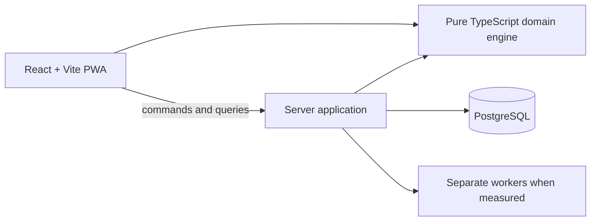

# Technical Architecture

## Status and principles

This document describes the selected direction; no application code exists yet. The system will start as a TypeScript monorepo and modular monolith with pragmatic Clean Architecture boundaries. Domain and application code remain independent of React, NestJS, network transport, and persistence.

NestJS is the recommended server framework because its modules and dependency injection fit the planned boundaries, but it is not implemented or irrevocably selected. The ORM is open. Prisma and Drizzle are candidates, not decisions.

## Planned structure

The initial monorepo shape is `apps/web`, `apps/api`, `packages/domain`, `packages/contracts`, and `packages/test-fixtures`. This is a target, not the current repository structure.

Modules should follow business capabilities such as access, competitions, participants, games, gridiron capture, statistics, synchronization, and publishing. Within a module, use domain, application, infrastructure, and interface layers only where they clarify dependencies. The domain engine is pure TypeScript: deterministic inputs produce deterministic state, statistics, and issues.

Runtime validation is required at every external boundary because TypeScript types do not exist at runtime. The server revalidates commands, permissions, and invariants even when the browser has already run the same engine.

## Data and computation

PostgreSQL stores structural relationships—organizations, teams, players, games, ordering, revisions, and projection rows—in relational columns and tables. Versioned JSONB is reserved for variable play details. Payload version is distinct from play revision. Frequently aggregated projections remain relational.

The ordered current play log plus retained revisions is the business source of truth. Score, game situation, and statistics are derived and reconstructible. This is relational persistence with history and projections, not full Event Sourcing. A correction rebuilds the affected match projection and may flag later observations as inconsistent.

Match projections feed season and league aggregates. Dashboard reads must not replay an entire season. A changed match projection updates only dependent aggregates, using source revisions to prevent stale work from overwriting newer results.

## Delivery and operational choices

The capture interface is a React/Vite PWA. A service worker caches application assets; IndexedDB through Dexie stores prepared games, local plays, and an outbox. Asset caching alone does not provide offline capture. Browser quota, persistence, reload, foreground resume, and target-device behavior require explicit tests and a recoverable export path.

HTTP carries commands and reads. Public views begin with periodic refresh. Add Server-Sent Events only when lower update latency is demonstrated; reconnection must still recover missed changes from a cursor or fresh snapshot.

CPU-heavy or long-running calculations must not block the API process. Introduce separate workers, bounded concurrency, and eventually a queue only after measurements justify them. Go, distributed caches, brokers, and microservices are not first-delivery requirements.

Voice and video are later capabilities. Voice transcription is remote and network-dependent: temporary audio produces a structured proposal that a human validates, with no durable audio retention planned. Touch capture remains the offline path. Native applications and video analysis are deferred.

See [ADR-001](../adr/ADR-001-choix-techniques-plateforme-statistiques.md) for rationale and [synchronization](synchronization.md) for command behavior.
