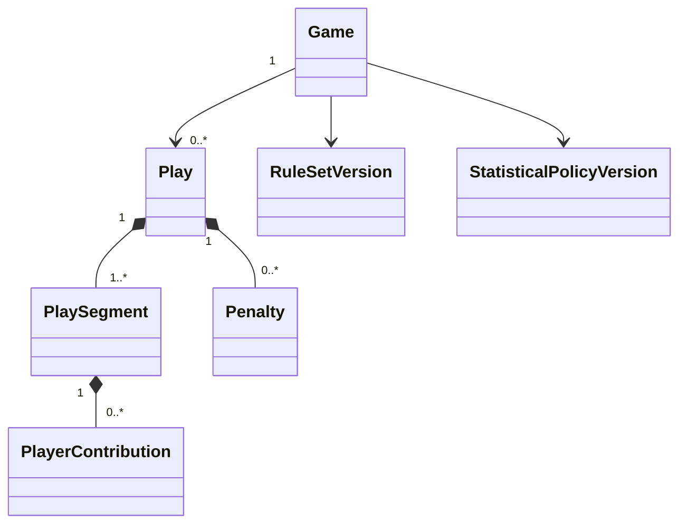

# Domain Model

## Source facts and derived results

A `Play` records an observation. Player contributions assign roles within that observation. Score, game situation, and statistics are derived results. A play may contain several ordered segments—for example pass, interception, return, fumble, recovery, and another return—so one start/end position cannot represent every attribution.

The first implementation should model only the segment types required by the prototype, without claiming full-game coverage. Unknown players or values are explicit review states, not invented entities. Live Capture may save a minimal `PlayObservation`; Review Mode enriches that same observation and revision history rather than creating another record.

## Ordered log and revisions

Each play has a stable ID, `gameId`, `orderKey`, current `revision`, `payloadVersion`, period and optional clock, observed context, play family, outcome, segments, penalties, contribution data, optional note, source, and author metadata. A participant may be represented temporarily by an observed jersey number without inventing a player identity. `orderKey` is independent of display number, clock, and UUID. References use stable IDs.

Three independent state dimensions prevent user-interface concerns from being confused with business review or delivery:

| Dimension | Values | Meaning |
| --- | --- | --- |
| `captureCompleteness` | `minimal`, `needs_details`, `complete` | Whether policy-required observation details are present |
| `reviewStatus` | `draft`, `needs_review`, `confirmed` | Whether a human has reviewed the observation |
| `syncStatus` | `local`, `pending`, `synced`, `conflict` | Local delivery state; not part of the authoritative domain payload |

The engine can calculate a provisional result from minimal observations and returns issues for unknown or contradictory facts. Saving the next play and closing field capture remain allowed; unresolved issues keep results provisional and may block statistical validation under the selected policy.

Game capture and statistical approval have separate lifecycles:

| Dimension | Values | Meaning |
| --- | --- | --- |
| `captureStatus` | `in_progress`, `closed` | Whether live field entry is still active |
| `resultStatus` | `provisional`, `validated` | Whether statistics have received the required approval |

Capture may close with unresolved plays. `UncertaintySummary` contains a unique `playCount`, affected play IDs, and counts by reason such as `missing_details`, `unresolved_identity`, `inconsistent_consequence`, `sync_conflict`, and `pending_delivery`. A play may have multiple reasons, so reason counts need not sum to `playCount`. Closing capture preserves pending commands and leaves Review Mode available.

A correction creates a revision rather than deleting history. The current ordered play versions form the calculation input; retained revisions explain who changed what, when, and why. Insertion or correction may invalidate the expected context of later plays. The engine must return explicit issues and require human resolution; recalculation must not rewrite a contradictory observation to fit the new state.

Materialized projections record `sourceGameRevision`, ruleset version, statistical-policy version, engine version, and computation time. They may be rebuilt and replaced only when their source revision is current.

`MexicanStatSheetProjection` is a team-centered read model derived from the canonical `GameProjection`. It contains offense, special teams, turnovers, penalties, scoring, first downs, defense, and compact play details. Its screen and PDF representations are outputs, never editable source state. A pre-game printable fallback sheet is a capture aid, not a calculated projection.

## Three independent versions

| Reference | Responsibility |
| --- | --- |
| Ruleset | Sport flow: downs, field, scoring, periods, conversions, and penalty consequences |
| Statistical policy | Attribution: passing, receiving, sacks, defensive credits, and penalty treatment |
| Engine version | Code that applies the selected rules and builds projections |

These references must not be collapsed. A ruleset contains data and, where necessary, versioned behavior; it is not assumed to be fully expressible as JSON. Historical games retain their selected versions. Old play payloads are read through versioned adapters or controlled migrations.

## Core invariants

- Home and away teams are distinct, and every identified contributor belongs to the game roster and acting team.
- Positions, periods, downs, and available roles obey the selected ruleset; four downs is not a universal hard-coded rule.
- A `complete` and `confirmed` observation contains required contributions or explicitly permitted unknowns.
- Validated results require authorized reopening before a correction can replace the approved projection.
- Ordering, possession changes, and segment consequences are coherent or reported as unresolved issues.
- Player passing and receiving yards are attributed separately, but team offense does not double-count them.
- Penalty enforcement and statistical attribution are distinct; final ball position alone cannot determine every credited yard.
- Closing capture is always allowed after confirming the uncertainty summary; statistical validation follows the selected policy and may require all mandatory completeness, review, synchronization, and consistency issues to be resolved.

## Initial engine contract

The pure TypeScript engine accepts initial context, ordered current plays, a ruleset, and a statistical policy. It returns game state, player and team statistics, scoring, and issues. Time, identifiers, persistence, authorization, and external services are supplied outside the engine.

Reference games must be approved independently of the implementation. A test oracle generated only by the same algorithm cannot validate the algorithm.
