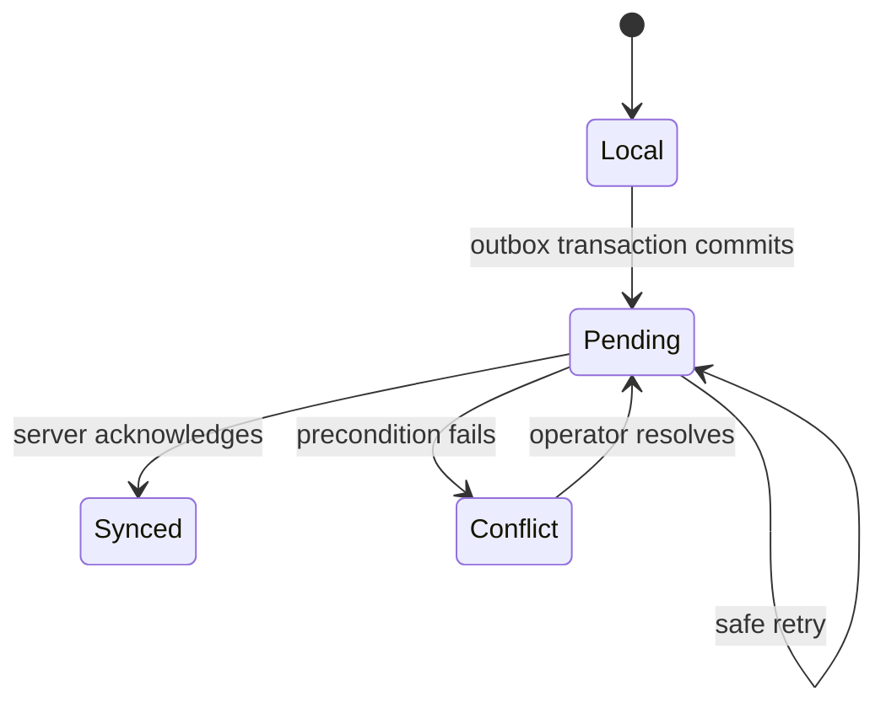

# Offline Synchronization

## Local-first flow

Preparing a game downloads its configuration, roster, selected ruleset and statistical policy, and current game revision. During capture, one IndexedDB transaction writes both the local play change and its command to a Dexie outbox. The UI may immediately rebuild provisional statistics, but it must not describe local persistence as server confirmation.

Synchronization runs when the network is available and the app is active, on foreground resume, and on explicit retry. Background execution is an optional optimization, never a correctness dependency.

## Command contract

Every command has a client-generated `commandId` distinct from the target play ID, `commandType`, `schemaVersion`, stable game/play targets, device and local-sequence diagnostics, applicable expected versions, a structured payload, and a client timestamp. Server identity and organization come from the authenticated session, not trusted payload fields.

`expectedPlayRevision` protects corrections. `expectedGameRevision` protects operations whose order or context can affect later plays. Commands are sent in causal order. One primary operator per game is the initial operating constraint, but version checks remain necessary for retries, multiple tabs or devices, and reviewer corrections.

## Server transaction and idempotency

The server validates authorization, payload schema, preconditions, and domain invariants. One database transaction stores the accepted change, retained revision, projection work marker where applicable, and a durable command receipt.

A repeated `commandId` with identical content returns the recorded result. The same ID with different content is rejected. This provides idempotent effects, not “exactly once” network delivery. A timeout after server commit is therefore safe to retry.

For each organization, the command ID is unique. The receipt must remain available long enough to cover supported retry behavior; the retention period is an open operational decision.

## Conflicts, ordering, and recovery

A stale expected revision returns a conflict with the current server state while preserving the local proposal for comparison. The client never overwrites either version silently. Insertions and corrections trigger reconstruction from the affected point. If a possession or context change contradicts later observations, the server reports affected plays. The operator may still close capture with those plays counted as uncertain; statistical validation remains subject to human resolution and the selected policy.

After acknowledgements, the client fetches server changes after its cursor or refreshes a canonical snapshot. Reconnection alone is insufficient because updates may have been missed. The UI distinguishes `local`, `pending`, `synced`, and `conflict` synchronization states from sport-review states such as `needs_review` or `confirmed`.

Storage exhaustion, rejected IndexedDB writes, reload during capture, repeated delivery, out-of-order delivery, server timeout after commit, stale revisions, and cursor recovery are mandatory tests. A recoverable export is required because browser storage is not a durable backup.
